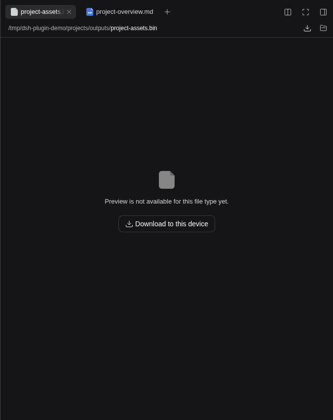
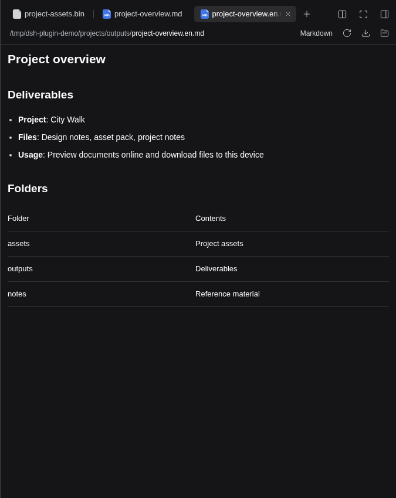

# DSH File Bridge

[简体中文](https://github.com/ousiqwq/dsh-file-bridge/blob/main/README.md) | **English**

Add a **Download to this device** action to DeepSeek Harness in a remote browser. Files are saved on the device viewing the page, alongside Harness's native previews and file lists.

Package: `dsh-plugin-file-bridge`.

The interface uses DSH native i18n and follows language changes immediately. Chinese and English dictionaries are included; other interface languages use the native English fallback.

## One-command installation

Supports the Web profile of DeepSeek Harness **0.2.1-rc.3 / 0.2.1-rc.5 / 0.2.2-rc.2**.

Install with **npx** (Node.js 26; no global dsh or pnpm installation required):

```bash
npx --yes --package=@deepseek-ai/dsh@0.2.2-rc.2 --package=pnpm@11.28.5 dsh plugin --profile web add dsh-plugin-file-bridge@latest
```

Run this on the DSH host with the same account and `DSH_HOME` as your existing instance. The command pins the verified official CLI and installs the latest plugin into the `web` profile. With the DSH CLI already installed, you can also use:

```bash
dsh plugin --profile web add dsh-plugin-file-bridge
```

Enable the plugin in the plugin manager and refresh the page. If the running instance has not loaded the new configuration, restart DSH and refresh. You can also download packages from [Releases](https://github.com/ousiqwq/dsh-file-bridge/releases).

## Agent preset compatibility

Verified against the native DeepSeek Harness **0.2.2-rc.2** Web service using real sessions, executors and file APIs:

| Preset | Capability Desk | Soul Desk | File Bridge |
| --- | --- | --- | --- |
| Standard `standard` | Skill/MCP catalogs, rules and invocation guards work | All three injection modes, memories and child policies work | Download and access checks work |
| PTC `ptc` | Disabled tools are omitted from the SDK and nested calls remain guarded | Preserves the `run_code` protocol and SDK; memory tools work through SDK calls | Works independently of tool-call style |
| Minimal `minimal` | Rules work without adding a Skill loader, editor or subagent tools | Persona and memory support preserves the preset's existing tool boundary | Works |
| Creation `cordis` | Skill/MCP rules preserve native creation tools | All three injection modes, memories and child policies work | Works |

Minimal does not ship a Skill loader or subagents; enabling a Skill does not install those tools into that preset. Global plugins can still contribute their own memory or MCP tools. Soul child policies default to no persona; parent reuse is explicit. Soul's Complete mode replaces the preset's prompt body while preserving executor protocol/SDK sections, tool schemas and native runtime context. Use Priority or Append to keep the original task instructions. Custom presets that isolate or replace underlying registries, and external ACP backends, need separate verification.

See [four-preset acceptance](docs/AGENT-PRESET-COMPATIBILITY.md).

## Features

- **Toolbar downloads:** open a file and use the download icon in the preview toolbar.
- **Download without a preview:** Unsupported formats get a download button in the preview placeholder.
- **Original contents and filenames:** binary files, Chinese filenames, spaces, and streamed large-file downloads.
- **Native previews:** documents, images, and spreadsheets continue to use Harness's existing viewers.
- **Native styling:** buttons, icons, tooltips, and light/dark themes match Harness.

### Download files

Choose **Download to this device** even when the file cannot be previewed.



### Preview and download

Read a document in its native viewer and download it from the toolbar.



## Usage

1. Click a file link in a conversation or open a file from the native file list.
2. Click the toolbar's download icon or **Download to this device** in the preview placeholder.
3. Use your browser's downloads list to view progress, cancel, retry, or open the downloaded file.

Your browser controls the save location. To use a local application, open the downloaded file from your browser or file manager. Harness still controls its native **Open** action, which may open a server-side application in remote deployments.

## Behavior and scope

- Uses DSH's session file access, authentication, and Host/Origin checks.
- Reads through native file APIs and streams downloads; supports single HTTP ranges, HEAD, and Chinese filenames.
- Rejects or interrupts downloads if the file changes during transfer, avoiding mixed versions.
- Download addresses expire after five minutes. Click again after expiry or a service restart.
- Handles regular files rather than folder archives. Available previews depend on Harness and its installed viewers.
- Integrates through public document-action slots with no runtime npm dependencies.

## Development

Use Node.js 22+:

```bash
npm test
npm run check
npm pack
```

Browser checks require an accessible Harness instance and Playwright/Chromium:

```bash
DSH_TEST_URL=http://your-harness-host:3080 npm run test:browser
```

Set `PLAYWRIGHT_MODULE` and `PLAYWRIGHT_CHROMIUM_EXECUTABLE` to reuse existing browser tools.

## License

[MIT](https://github.com/ousiqwq/dsh-file-bridge/blob/main/LICENSE) © 2026 osiqwq
