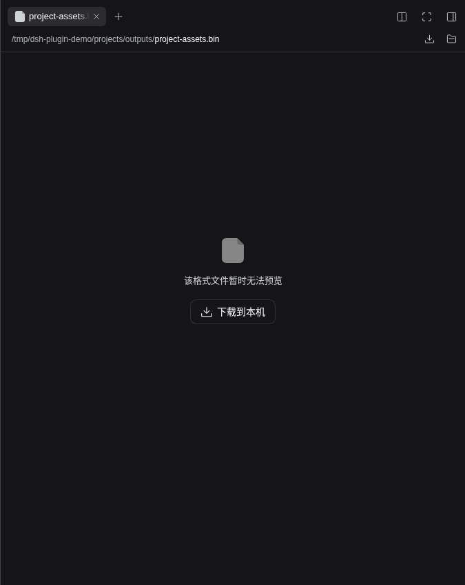
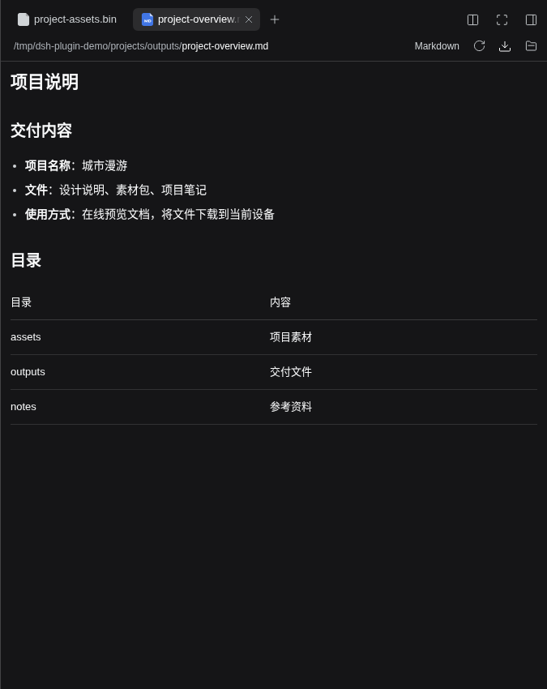

# DSH File Bridge

**简体中文** | [English](https://github.com/ousiqwq/dsh-file-bridge/blob/main/README.en.md)

为远程浏览器中的 DeepSeek Harness 添加 **下载到本机** 按钮。文件直接保存到访问网页的设备上，与原生预览和文件列表配合使用。

插件包：`dsh-plugin-file-bridge`

界面接入 DSH 原生 i18n，实时跟随 DSH 的语言设置。内置中英文词典；其他界面语言按 DSH 的规则回退到英文。

## 一键安装

支持 DeepSeek Harness **0.2.1-rc.3 / 0.2.1-rc.5 / 0.2.2-rc.2** 的 Web profile。

通过 **npx** 安装（Node.js 26，无需全局安装 dsh 或 pnpm）：

```bash
npx --yes --package=@deepseek-ai/dsh@0.2.2-rc.2 --package=pnpm@11.28.5 dsh plugin --profile web add dsh-plugin-file-bridge@latest
```

在运行 DSH 的主机上，用原实例相同的账户和 `DSH_HOME` 执行。命令固定本轮验证的官方 DSH CLI，插件安装最新版；`web` 是目标 profile。已安装 DSH CLI 时也可使用：

```bash
dsh plugin --profile web add dsh-plugin-file-bridge
```

在插件管理中启用插件并刷新页面。如果运行实例尚未加载新配置，重启 DSH 后刷新。也可以从 [Releases](https://github.com/ousiqwq/dsh-file-bridge/releases) 下载安装包。

## Agent 预设兼容性

本轮在 DeepSeek Harness **0.2.2-rc.2** 的原生 Web 服务中，使用真实会话、工具执行器和文件接口逐项验证：

| 预设 | Capability Desk | Soul Desk | File Bridge |
| --- | --- | --- | --- |
| 标准 `standard` | Skill/MCP 规则、目录及调用拦截有效 | 三种注入方式、记忆与子代理规则有效 | 文件下载及权限校验有效 |
| PTC `ptc` | SDK 中隐藏禁用工具，嵌套调用仍受拦截 | 保留 `run_code` 协议与工具 SDK，记忆可从 SDK 调用 | 同样有效，与工具调用形式无关 |
| 极简 `minimal` | 规则仍有效；不会额外添加 Skill 加载、编辑或子代理工具 | 人设与记忆有效，保留预设原有工具边界 | 同样有效 |
| 创造 `cordis` | Skill/MCP 规则有效，不移除原生创造工具 | 三种注入方式、记忆与子代理规则有效 | 同样有效 |

极简模式没有原生 Skill 加载器或子代理，启用某项 Skill 不会为该预设补装这些工具。全局插件仍可提供自己的记忆或 MCP 工具。子代理策略以 Soul 的设置为准，默认不使用人设；复用派出者需明确配置。Soul 的“替换”模式替换预设提示词正文，但保留执行器协议/SDK、工具 schema 和原生运行上下文；希望保留原有任务说明时使用“优先”或“追加”。自定义预设若隔离或替换底层注册表、外部 ACP 后端，不在本次统一保证范围。

详见 [四模式验收](docs/AGENT-PRESET-COMPATIBILITY.md)。

## 功能

- **预览工具栏下载**：打开文件后，点击右侧工具栏的下载图标。
- **无法预览的文件也能下载**：无法预览的文件在提示区提供下载按钮。
- **保留文件内容与名称**：支持二进制文件、中文名、空格与大文件流式传输。
- **原生预览继续使用**：文档、图片、表格等沿用 Harness 已有的预览能力。
- **原生界面样式**：按钮、图标、提示和深浅主题与 Harness 保持一致。

### 下载文件

打开不支持预览的文件后，可直接选择 **下载到本机**。



### 预览与下载

在原生预览中阅读文档，同时使用顶部工具栏的下载按钮。



## 使用

1. 点击对话中的文件链接，或从原生文件列表打开文件。
2. 点击工具栏下载图标，或预览提示区的 **下载到本机**。
3. 在浏览器下载列表中查看进度、取消、重试或打开文件。

文件保存位置由当前浏览器决定。需要本机应用时，下载后从浏览器或文件管理器打开。原生 **打开** 按钮仍由 Harness 处理，远程部署时可能打开服务端应用。

## 行为与范围

- 沿用 DSH 的会话文件访问范围、认证和 Host/Origin 检查。
- 使用原生文件接口分段读取并流式下载，支持单段 HTTP Range、HEAD 和中文文件名。
- 文件在传输期间发生变化时拒绝或中断下载，避免混合不同版本。
- 下载地址有效期为五分钟；过期或服务重启后，重新点击按钮生成新地址。
- 处理普通文件，不打包文件夹；具体预览格式取决于 Harness 版本及其预览组件。
- 通过公开的文档操作插槽集成，无运行时 npm 依赖。

## 开发

使用 Node.js 22+：

```bash
npm test
npm run check
npm pack
```

浏览器检查需要可访问的 Harness 实例和 Playwright/Chromium：

```bash
DSH_TEST_URL=http://your-harness-host:3080 npm run test:browser
```

可通过 `PLAYWRIGHT_MODULE` 和 `PLAYWRIGHT_CHROMIUM_EXECUTABLE` 指定已有浏览器工具。

## 许可证

[MIT](https://github.com/ousiqwq/dsh-file-bridge/blob/main/LICENSE) © 2026 osiqwq
